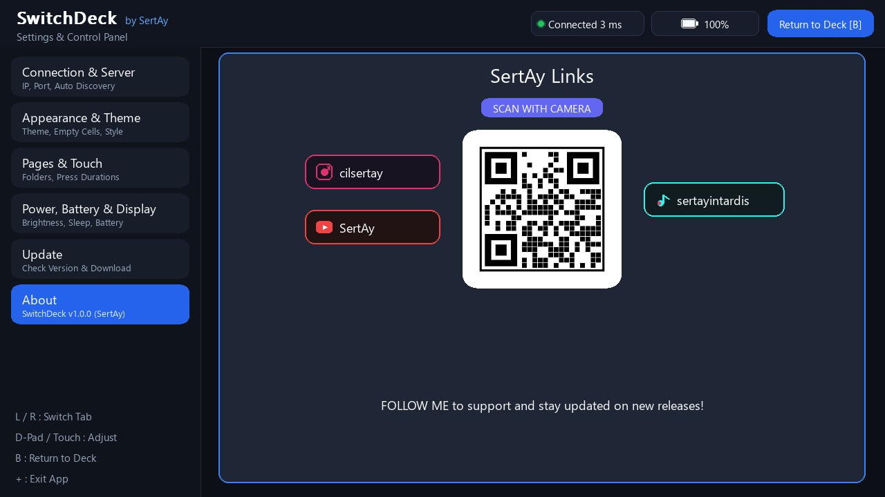

<h1 align="center">SwitchDeck</h1>

  <picture>
    <source media="(prefers-color-scheme: dark)" srcset="romfs/logo_dark.png">
    
  </picture>

  <strong>Turn your Nintendo Switch into a Macro Deck control panel.</strong> 
  Nintendo Switch’ini Macro Deck kontrol paneline dönüştür.

  
  
  
  

  

<table align="center">
  <tr>
    <th>HB App Store</th>
    <th>SertAy · Linktree</th>
  </tr>
  <tr>
    <td align="center"></td>
    <td align="center"></td>
  </tr>
  <tr>
    <td align="center"><a href="https://hb-app.store/switch/SwitchDeck">Open in store · Mağazada aç</a></td>
    <td align="center"><a href="https://linktr.ee/yamanx">All links · Tüm linkler</a></td>
  </tr>
</table>

---

## Screenshots · Ekran Görüntüleri

   
  <strong>Connection &amp; Server · Bağlantı ve Sunucu</strong>

   
  <strong>Appearance &amp; Theme · Görünüm ve Tema</strong>

   
  <strong>About · Hakkında</strong>

---

## 🇬🇧 English

### What SwitchDeck does

Open your PC’s **Macro Deck 3** pages on the Switch. Run macros, change tracks, and adjust volume while you play or stream.

- **Macros and media** — Use buttons with the touchscreen or Joy-Con, and control Spotify and volume.
- **Live widgets** — View album art, weather, clocks, timers, and CPU, GPU, and RAM gauges.
- **Appearance** — Choose the Macro Deck, Light, or OLED Pure Black theme. Dim or black out the idle screen, or put the console to sleep.

### Installation

You need a Nintendo Switch running CFW with access to the Homebrew Menu and a PC running Macro Deck 3 on the same local network.

1. Open SwitchDeck in the [HB App Store](https://hb-app.store/switch/SwitchDeck) or [download the SD ZIP from GitHub Releases](https://github.com/sertay1/switchdeck/releases).
2. If you use the ZIP, copy its `switch` folder to the root of your SD card.
3. Launch **SwitchDeck** from the Homebrew Menu. The NRO should be at `SD:/switch/SwitchDeck/SwitchDeck.nro`.

### Pairing

1. Add a profile with at least one widget or action in Macro Deck on your PC.
2. On the Switch, open **Settings → Connection & Server → Search Network** to find your PC. You can also enter the IP address and port manually. Macro Deck 3 defaults to port `8193`.
3. On your PC, open **Devices → Add Device** to get a six-digit code. Enter it on the Switch and select **Connect Now**.

The pairing is saved on your SD card. Pair again if the server address or port changes. For Macro Deck 2, enter your server port manually and leave the code blank.

### Controls

| Input | Action |
| --- | --- |
| Touch or A | Activate a widget |
| L / R | Switch pages |
| ZL / ZR | Adjust a slider |
| B | Go back |
| X / − | Open Settings |
| Y | Reload the deck or reconnect |
| + | Exit the app |

### Updating

Copy the new `SwitchDeck.nro` to `SD:/switch/SwitchDeck/` and replace the old NRO.

Build from source

Install devkitPro, devkitA64, libnx, and the Switch portlibs listed in the [Makefile](Makefile). Run `make` in the devkitPro shell to build `SwitchDeck.nro`. [Test instructions](tests/README.txt).

---

## 🇹🇷 Türkçe

### SwitchDeck ne işe yarar?

Bilgisayarındaki **Macro Deck 3** sayfalarını Switch’te aç. Oyun veya yayın sırasında makroları çalıştır, parçayı değiştir ve sesi ayarla.

- **Makrolar ve medya** — Dokunmatik ekran veya Joy-Con ile düğmeleri kullan, Spotify’ı ve ses seviyesini kontrol et.
- **Canlı widget’lar** — Albüm kapağını, hava durumunu, saati, sayaçları ve CPU, GPU, RAM göstergelerini görüntüle.
- **Görünüm** — Macro Deck, Açık veya OLED Tam Siyah temasını seç. Boşta ekranı karart, siyaha al veya konsolu uyut.

### Kurulum

Homebrew Menu’ye erişebilen CFW’li bir Nintendo Switch ve aynı yerel ağda Macro Deck 3 çalıştıran bir bilgisayar gerekir.

1. SwitchDeck’in sayfasını [HB App Store’da aç](https://hb-app.store/switch/SwitchDeck) veya [GitHub Releases’tan SD ZIP’ini indir](https://github.com/sertay1/switchdeck/releases).
2. ZIP ile kuruyorsan içindeki `switch` klasörünü SD kartın köküne kopyala.
3. Homebrew Menu’den **SwitchDeck**’i başlat. NRO’nun yolu `SD:/switch/SwitchDeck/SwitchDeck.nro` olmalı.

### Eşleştirme

1. Bilgisayarda Macro Deck’e bir profil ve en az bir widget veya eylem ekle.
2. Switch’te **Ayarlar → Bağlantı & Sunucu → Ağda Ara** ile bilgisayarını bul. IP adresini ve portu elle de girebilirsin. Macro Deck 3’ün varsayılan portu `8193`.
3. Bilgisayarda **Cihazlar → Cihaz Ekle** bölümünden altı haneli kod al. Switch’e girip **Şimdi Bağlan**’a bas.

Eşleştirme SD kartta saklanır. Sunucu adresi veya portu değişirse yeniden eşleştir. Macro Deck 2 için sunucu portunu elle gir ve kod alanını boş bırak.

### Kontroller

| Tuş | İşlev |
| --- | --- |
| Dokunma veya A | Widget’ı çalıştır |
| L / R | Sayfa değiştir |
| ZL / ZR | Kaydırıcıyı ayarla |
| B | Geri dön |
| X / − | Ayarları aç |
| Y | Deck’i yenile veya yeniden bağlan |
| + | Uygulamadan çık |

### Güncelleme

Yeni `SwitchDeck.nro` dosyasını `SD:/switch/SwitchDeck/` klasörüne kopyalayıp eski NRO’nun üzerine yaz.

Kaynak koddan derleme

devkitPro, devkitA64, libnx ve [Makefile](Makefile)’daki Switch portlibs paketlerini kur. devkitPro kabuğunda `make` komutuyla `SwitchDeck.nro` oluştur. [Test talimatları](tests/README.txt).

