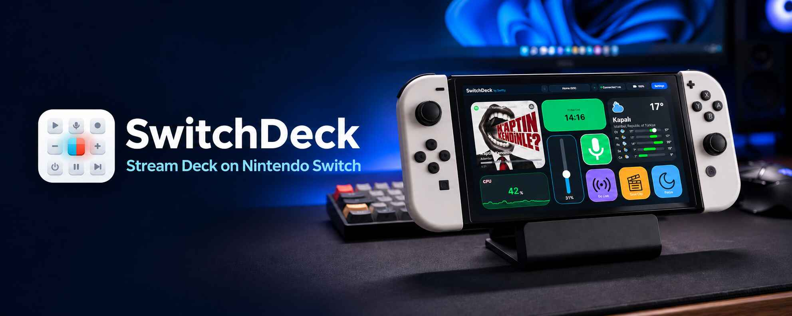
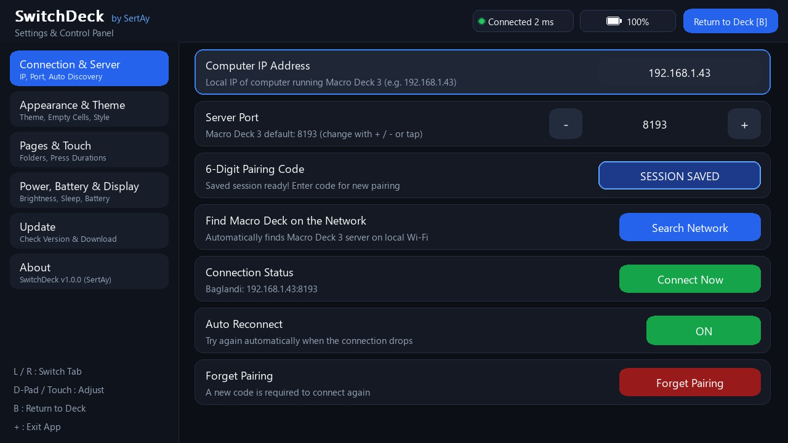
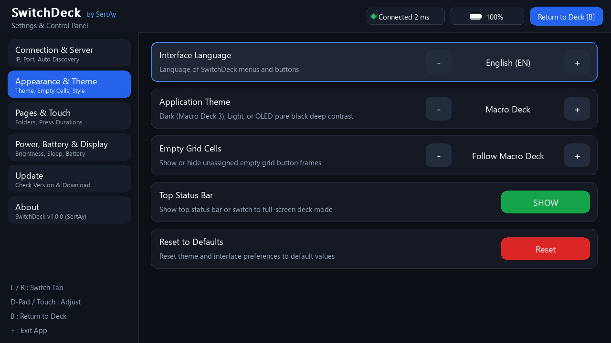

  <picture>
    <source media="(prefers-color-scheme: dark)" srcset="romfs/logo_dark.png">
    
  </picture>

<h1 align="center">SwitchDeck</h1>

  <strong>Macro Deck kontrol panelin Nintendo Switch’inde.</strong> 
  Your Macro Deck control panel, on Nintendo Switch.

  <a href="#tr-kurulum-ve-kullanim-rehberi"><strong>Türkçe</strong></a> ·
  <a href="#en-setup-and-usage-guide"><strong>English</strong></a> ·
  <a href="#screenshots">Ekran görüntüleri / Screenshots</a>

  

  <a href="https://github.com/sertay1/switchdeck/releases"><strong>SD paketini indir / Download SD package</strong></a> ·
  <a href="https://hb-app.store/switch/SwitchDeck">HB App Store</a>

---

## 🇹🇷 Türkçe

SwitchDeck, bilgisayarında hazırladığın **Macro Deck 3** profillerini Nintendo Switch’e taşır. Oyun veya yayın sırasında Switch’in dokunmatik ekranından ya da Joy-Con tuşlarıyla makro çalıştırabilir, sesi ayarlayabilir, Spotify parçalarını değiştirebilirsin.

- **Widget’lar** — Albüm kapağı, hava durumu, saat, sayaçlar ve CPU, GPU, RAM göstergeleri.
- **Görünüm** — Macro Deck, Açık ve OLED Tam Siyah temaları, ayarlanabilir durum çubuğu.
- **Boşta ekran** — Karartma, OLED için siyah ekran veya konsolu uykuya alma.

### Kurulum ve eşleştirme

**Gerekenler** — Homebrew Menu’ye erişebilen CFW’li bir Nintendo Switch ve aynı yerel ağda [Macro Deck 3](https://macro-deck.app/) çalıştıran bir bilgisayar.

1. [SD ZIP’ini indir](https://github.com/sertay1/switchdeck/releases). ZIP’teki `switch` klasörünü SD kartın köküne kopyala ve Homebrew Menu’den **SwitchDeck**’i aç.
2. SwitchDeck’te **Ayarlar → Bağlantı & Sunucu → Ağda Ara** ile bilgisayarını bul. Elle bağlanmak için bilgisayarın IP adresini ve sunucu portunu gir. Varsayılan port `8193`.
3. Bilgisayarda Macro Deck’in **Cihazlar → Cihaz Ekle** bölümünden altı haneli kod al. Kodu Switch’e girip **Şimdi Bağlan**’a bas.

**Güncelleme** — Yeni `SwitchDeck.nro` dosyasını `SD:/switch/SwitchDeck/` klasörüne kopyalayıp mevcut NRO’nun üzerine yaz.

**Joy-Con tuşları** — Yön tuşları odağı taşır, **A** widget’ı çalıştırır, **L / R** sayfayı değiştirir, **ZL / ZR** kaydırıcıyı ayarlar. **B** geri döner, **X / −** ayarları açar, **Y** yeniler, **+** uygulamadan çıkar.

---

## 🇬🇧 English

SwitchDeck brings your PC’s **Macro Deck 3** profiles to Nintendo Switch. Run macros, adjust volume, and skip Spotify tracks from the touchscreen or Joy-Con buttons while you play or stream.

- **Widgets** — Album art, weather, clocks, timers, and CPU, GPU, and RAM gauges.
- **Appearance** — Macro Deck, Light, and OLED Pure Black themes with an optional status bar.
- **Idle display** — Dim the screen, show black for OLED, or put the console to sleep.

### Install and pair

**Requirements** — A Nintendo Switch running custom firmware with access to the Homebrew Menu, and a PC running [Macro Deck 3](https://macro-deck.app/) on the same local network.

1. [Download the SD ZIP](https://github.com/sertay1/switchdeck/releases). Copy its `switch` folder to the root of your SD card and open **SwitchDeck** from the Homebrew Menu.
2. Open **Settings → Connection & Server → Search Network** to find your PC. You can also enter its IP address and server port manually. The default port is `8193`.
3. In Macro Deck on your PC, open **Devices → Add Device** and generate a six-digit code. Enter it on your Switch and select **Connect Now**.

**Updating** — Replace the existing `SwitchDeck.nro` in `SD:/switch/SwitchDeck/`.

**Joy-Con controls** — Use the D-pad to move focus, **A** to activate a widget, **L / R** to switch pages, and **ZL / ZR** to adjust a slider. **B** goes back, **X / −** opens Settings, **Y** reloads the deck, and **+** exits.

---

## 📸 Ekran görüntüleri / Screenshots

   
  <strong>Bağlantı ve eşleştirme · Connection and pairing</strong>

   
  <strong>Görünüm ve tema · Appearance and theme</strong>

   
  <strong>Hakkında · About</strong>

Kaynak koddan derleme / Build from source

devkitPro, devkitA64, libnx ve [Makefile](Makefile)’da listelenen Switch portlibs paketlerini kur. devkitPro kabuğunda `make` çalıştırarak `SwitchDeck.nro` oluştur. [Test talimatları](tests/README.txt).

Install devkitPro, devkitA64, libnx, and the Switch portlibs listed in the [Makefile](Makefile). Run `make` in the devkitPro shell to build `SwitchDeck.nro`. [Test instructions](tests/README.txt).

---

## HB App Store

  

## İletişim / Contact

   
  <a href="https://linktr.ee/yamanx"><strong>SertAy · Tüm Linkler / All Links</strong></a>

