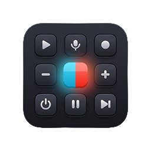
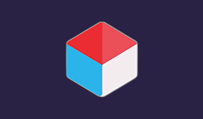
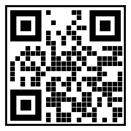

<picture>
  <source media="(prefers-color-scheme: dark)" srcset="romfs/logo_dark.png">
  
</picture>

<h1 align="center">SwitchDeck</h1>

---

  <strong>(EN)</strong> Turn your Nintendo Switch into a Streamdeck panel.
    
  <strong>(TR)</strong> Nintendo Switch’inizi Streamdeck kontrol paneline dönüştürün.

  
    
  
  &nbsp;&nbsp;
  

---

## (EN) Setup and Usage Guide

### ✨ Features

- **Macro Deck on Switch** — Browse your PC’s profiles and folders, run macros, and use your configured button styles.
- **Live widgets** — Control playback and volume, see Spotify album art, and view weather, clocks, timers, and CPU, GPU, and RAM gauges.
- **Appearance and idle display** — Choose Macro Deck, Light, or OLED Pure Black. Set the status bar and decide whether an idle console dims, shows a black screen, or goes to sleep.
- **Touch and Joy-Con controls** — Use the touchscreen or navigate with physical buttons. The app supports English and Turkish.

  

### 💾 Step 1 — Installation

**Requirements** — A Nintendo Switch running custom firmware (CFW) with access to the Homebrew Menu, and a PC running [Macro Deck 3](https://macro-deck.app/) on the same local network.

**Method 1 — Homebrew App Store**

  
   
  <a href="https://hb-app.store/switch/SwitchDeck">HB Store Download Link</a>

**Method 2 — Manual installation**

1. Get the SD ZIP from [GitHub Releases](https://github.com/sertay1/switchdeck/releases).
2. Extract it and copy the included `switch` folder to the root of your SD card.
3. Launch **SwitchDeck** from the Homebrew Menu. The NRO goes at `SD:/switch/SwitchDeck/SwitchDeck.nro`.

### 🎮 Step 2 — How to Use

1. Create a profile with a widget or action in Macro Deck on your PC.
2. On the Switch, open **Settings → Connection & Server** and select **Search Network**. You can also enter the PC’s IP and port manually. Macro Deck 3 defaults to `8193`.
3. On the PC, open **Devices → Add Device** and generate a six-digit pairing code. Enter it on the Switch and select **Connect Now**.
4. Use the touchscreen or the D-pad and **A** button to activate widgets. Use **L / R** to switch pages and **ZL / ZR** to adjust a focused slider.

**Other controls** — Press **B** to go back, **X / −** for Settings, **Y** to reload or reconnect, and **+** to exit.

SwitchDeck saves the pairing on the SD card. Pair again if the server address or port changes. For Macro Deck 2, enter your server’s port and leave the pairing code blank.

  

**Build from source** — Install devkitPro, devkitA64, libnx, and the Switch portlibs listed in the [Makefile](Makefile). Run `make` in the devkitPro shell to build `SwitchDeck.nro`. The build embeds the [CA bundle](romfs/tls-ca-bundle.pem) for GitHub requests. See the [regression test instructions](tests/README.txt).

---

## 🔗 Contact and Donate

### SertAy

| Links | QR Code |
| :--- | :--- |
| **All Links** · [My Linktree](https://linktr.ee/yamanx) |  |

---

## (TR) Kurulum ve Kullanım Rehberi

### ✨ Özellikler

- **Switch’te Macro Deck** — Bilgisayarınızdaki profil ve klasörlere göz atın, makroları çalıştırın ve ayarladığınız düğme stillerini kullanın.
- **Canlı widget’lar** — Müziği ve ses seviyesini kontrol edin. Spotify albüm kapağını, hava durumunu, saati, sayaçları ve CPU, GPU, RAM göstergelerini takip edin.
- **Görünüm ve boşta ekran** — Macro Deck, Açık veya OLED Tam Siyah temasını seçin. Üst durum çubuğunu ve boşta ekran davranışını ayarlayın.
- **Dokunmatik ekran ve Joy-Con desteği** — Widget’ları dokunarak veya fiziksel tuşlarla kullanın. Arayüz Türkçe ve İngilizce kullanılabilir.

### 💾 1. Aşama — Kurulum

**Gereksinimler** — Özel yazılım (CFW) çalıştıran, Homebrew Menu’ye erişebilen bir Nintendo Switch ve aynı yerel ağda [Macro Deck 3](https://macro-deck.app/) çalıştıran bir bilgisayar.

**Yöntem 1 — Homebrew App Store**

  
   
  <a href="https://hb-app.store/switch/SwitchDeck">HB Store İndirme Linki</a>

**Yöntem 2 — Manuel kurulum**

1. [GitHub Releases](https://github.com/sertay1/switchdeck/releases) sayfasından SD ZIP paketini indirin.
2. ZIP’i açıp içindeki `switch` klasörünü SD kartın köküne kopyalayın.
3. Homebrew Menu’den **SwitchDeck**’i açın. NRO’nun yolu `SD:/switch/SwitchDeck/SwitchDeck.nro` olmalı.

### 🎮 2. Aşama — Uygulamanın Kullanımı

1. Bilgisayarda Macro Deck’te bir profil oluşturup widget veya eylem ekleyin.
2. Switch’te **Ayarlar → Bağlantı & Sunucu** bölümünden **Ağda Ara**’yı seçin. Bilgisayarın IP adresini ve portu elle de girebilirsiniz. Macro Deck 3’ün varsayılan portu `8193`.
3. Bilgisayarda **Cihazlar → Cihaz Ekle** bölümünden altı haneli kod alın. Kodu Switch’e girip **Şimdi Bağlan**’a basın.
4. Widget’ları dokunarak veya yön tuşları ve **A** ile kullanın. Sayfaları **L / R**, odaktaki kaydırıcıyı **ZL / ZR** ile kontrol edebilirsiniz.

**Diğer tuşlar** — **B** geri döner, **X / −** Ayarlar’ı açar, **Y** yeniler veya yeniden bağlanır, **+** uygulamadan çıkar.

SwitchDeck eşleştirmeyi SD kartta saklar. Sunucu adresi veya port değişirse yeniden eşleştirin. Macro Deck 2 için sunucunuzu elle girip eşleştirme kodunu boş bırakın.

  

**Kaynak koddan derleme** — devkitPro, devkitA64, libnx ve [Makefile](Makefile) içindeki Switch portlibs bağımlılıklarını kurun. devkitPro kabuğunda `make` komutuyla `SwitchDeck.nro` oluşturabilirsiniz. GitHub istekleri için [CA sertifika paketi](romfs/tls-ca-bundle.pem) NRO’ya gömülür. Ayrıntılar için [regresyon testi talimatlarına](tests/README.txt) bakın.

---

## 🔗 İletişim ve Bağış

### SertAy

| Linkler | QR Kod |
| :--- | :--- |
| **Tüm Linkler** · [Linktree Sayfam](https://linktr.ee/yamanx) |  |
